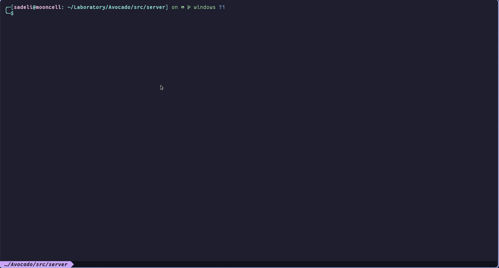
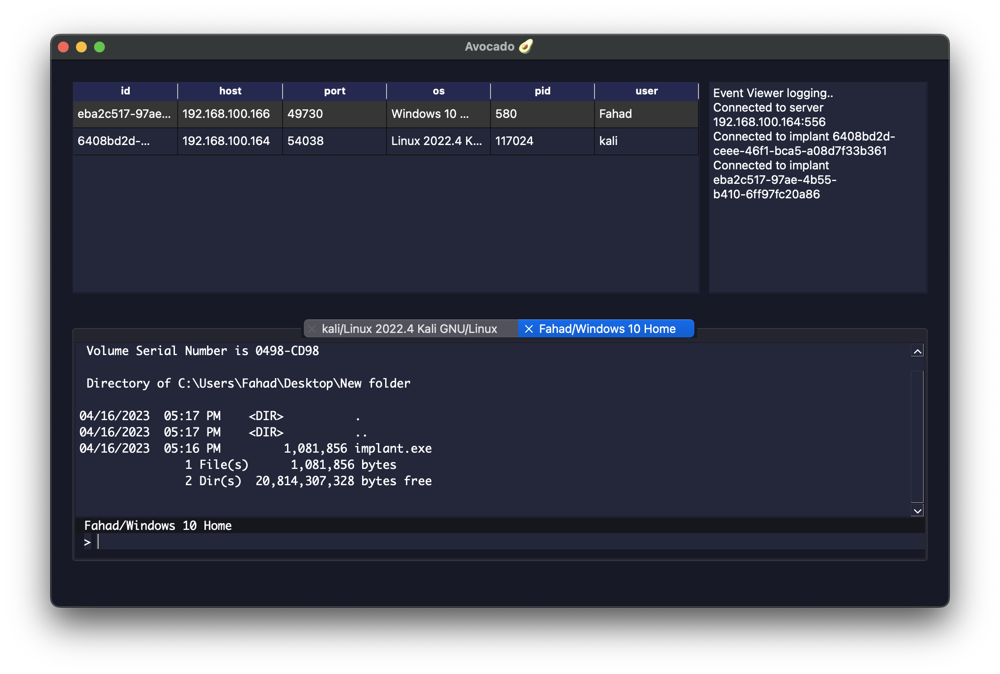

<h1 align="center">
  <picture>
    <source media="(prefers-color-scheme: dark)" srcset="https://user-images.githubusercontent.com/70419560/226087624-a4c6a4b6-11fc-4195-9878-cb19b6089b66.png">
    
  </picture>
  Avocado C2
</h1>

<p align="center">
  Avocado is a C2 framework currently in development. Expect bugs.
  <br>

  <!-- Open github issues -->
  <a href="https://github.com/ProDefense/Avocado/issues?q=is%3Aissue+is%3Aopen+">
    
  </a>

  <!-- Closed github issues -->
  <a href="https://github.com/ProDefense/Avocado/issues?q=is%3Aissue+is%3Aclosed">
    
  </a>

  <!-- License -->
  

  
</p>

## Quick Start

Avocado currently only supports a Docker installation. You can run everything from your host; no need to attach into the container.

1. **Build and start the server**
```bash
docker compose up -d --build server
```
The server listens for implants on port **31337** and for operators on **31338**.

2. **Run the CLI operator** (in a new terminal)
```bash
docker compose run --rm operator
```
The operator connects to the server automatically. No `docker exec` or shell inside the container.

3. **Generate an implant** from the operator prompt
```
[Avocado] > generate <host:port> <linux|windows>
```
Example: `generate 192.168.1.100:31337 linux`. The built implant is written to the **`implant-out/`** directory in the repo (mounted from the container).

To use a different output directory on your machine, run the operator with a bind mount:
```bash
docker compose run --rm -v /path/on/host:/home/avocado/implant-out -e IMPLANT_OUT_DIR=/home/avocado/implant-out operator
```

### Alternative: plain Docker

Without compose, run the server with env vars so it doesn’t prompt:
```bash
docker build -t avocado .
docker run --rm -p 31337:31337 -p 31338:31338 \
  -e IMPLANT_LISTENER=0.0.0.0:31337 -e OPERATOR_LISTENER=0.0.0.0:31338 \
  --name avocado avocado
```
In another terminal, run the operator (set the server address to your host’s Docker IP or `host.docker.internal:31338` if the operator runs on the host):
```bash
docker run --rm -it --add-host=host.docker.internal:host-gateway \
  -e OPERATOR_SERVER_ADDRESS=host.docker.internal:31338 \
  --name avocado-operator avocado operator
```
To get a shell inside the container: `docker run --rm -it avocado bash`.

## GUI Operator


Only manual installation is supported for the GUI operator. See [operator README](src/client/README.md) for more instructions.
